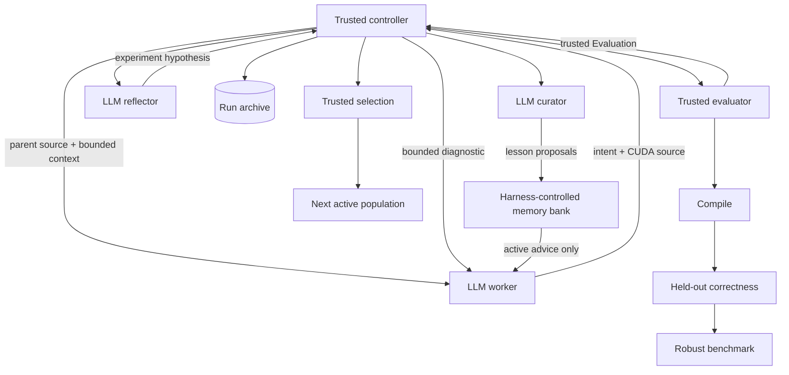

# KernelBunny

KernelBunny is a compact LLM harness that proposes CUDA SGEMM kernels, then
independently compiles, validates, benchmarks, reflects on, and evolves them.
The model proposes experiments; the harness decides whether they are valid and
useful.

The MVP targets row-major FP32 SGEMM (`C = A x B`) for arbitrary positive
dimensions. It intentionally uses a small evolutionary population rather than
a general multi-agent framework.

## Architecture



The trust boundary is the central design decision:

| LLM-controlled, untrusted | Harness-controlled, trusted |
|---|---|
| CUDA candidate source | Candidate and revision identity |
| Worker intent | Compilation and correctness results |
| Repair proposal | Benchmark configuration and runtime |
| Reflection hypothesis | Repair and candidate budgets |
| Curated lesson wording | Lesson IDs, promotion, and visibility |
| | Selection, best-ever state, and stopping |

Correctness is a hard constraint, not part of a weighted score. An incorrect
kernel is never benchmarked or admitted to the active population, regardless
of its apparent speed.

## How the pieces connect

- `main.py` parses operator configuration, validates the baseline, and wires the system together.
- `controller.py` owns identities, repairs, population state, selection, stopping, reflection scheduling, and curation scheduling.
- `worker.py` requests one CUDA mutation or one authorized repair from the LLM.
- `evaluator.py` compiles first, runs trusted correctness second, and benchmarks only valid kernels.
- `trusted/runner.cu` contains the executable CUDA test protocol, input generation, CPU oracle comparison, and event timing.
- `trusted/correctness.py` selects held-out cases and invokes the runner; it does not expose those cases to workers.
- `trusted/benchmark.py` invokes repeated timing and computes the median.
- `reflector.py` distinguishes the worker's intent, trusted observations, and a post-hoc hypothesis.
- `curator.py` proposes cross-experiment lessons; `memory.py` independently assigns IDs and decides promotion.
- `models.py` contains the small immutable records shared across those boundaries.
- `runs/` is the append-only experiment archive; `memory/` is compact cross-search advice.

## Candidate lifecycle

A logical candidate consumes one candidate-budget slot and may have multiple
source revisions:

```text
C0002/r0  initial proposal fails compilation
C0002/r1  authorized compile repair fails correctness
C0002/r2  authorized correctness repair passes and is benchmarked
```

Repairs do not consume additional candidate slots. The controller owns both
repair counters, and each revision is separately archived. Three search states
remain distinct:

- **Archive:** every attempted candidate and failed revision.
- **Active population:** candidates selected to receive future mutations.
- **Best-ever:** fastest validated candidate seen during the entire search.

Selection keeps the fastest valid candidates while reserving a slot for an
unrepresented parent branch when possible. The best-ever candidate is tracked
separately, so exploration cannot erase it.

## Setup

Requirements are an NVIDIA GPU and driver, CUDA 12.x tooling, Python 3.10+, and
a DeepSeek API key. The included VS Code devcontainer installs the compiler and
Python tooling and requests GPU access.

```bash
cp .env.example .env
# Edit .env and set DEEPSEEK_API_KEY.
python3 -m kernelbunny.main
```

The argument-free command only displays help; it never starts CUDA work or a
paid request.

First prove that the trusted evaluator works without involving an LLM:

```bash
python3 -m kernelbunny.main baseline
```

Then run a deliberately small search:

```bash
python3 -m kernelbunny.main search \
  --population-size 2 \
  --children-per-parent 1 \
  --max-generations 2 \
  --max-candidates 3 \
  --curation-interval-generations 1
```

Use `python3 -m kernelbunny.main search --help` for all operator-controlled
budgets, timeouts, benchmark repetition counts, paths, and model settings. The
default search allows 3 active candidates, 2 children per parent, 6 generations,
and at most 12 logical candidates.

## Persistent evidence

Each candidate revision remains inspectable instead of relying on LLM context:

```text
runs/C0002/
├── metadata.json
├── r0/
│   ├── candidate.cu
│   ├── raw_response.txt
│   ├── compile.log
│   ├── correctness.log
│   ├── benchmark.log
│   └── evaluation.json
└── r1/
    ├── candidate.cu
    ├── reflection.json
    └── reflection.md
```

Search-level `state.json` records the trusted configuration, generations,
selection decisions, active population, best-ever candidate, stopping reason,
curations, and active memory. `memory/global_memory.json` is machine-readable;
the Markdown view is for people; the JSONL archive preserves prior curation
updates.

## Tests

Fast unit tests use fake providers and evaluators:

```bash
python3 -m compileall -q kernelbunny tests
python3 -m unittest discover -s tests -p 'test_*.py' -q
```

The final opt-in acceptance test spends real API budget and requires the GPU:

```bash
python3 -m tests.live_phase9
```

It runs two generations with at most three logical candidates in an isolated
`runs/phase9-live/Txxxx` session. Optimization results naturally vary, so the
acceptance condition is correct orchestration and preserved evidence—not a
guaranteed speedup.

### Recorded MVP acceptance run

On 2026-09-07, the Phase 9 test ran against the real DeepSeek API and CUDA on
the project's RTX 3060 development environment:

- Trusted baseline: `0.423796 ms`.
- `C0001/r0`: compiled and passed the small held-out correctness suite, but the
  benchmark's independent output check found 138,575 mismatches. It received no
  runtime and was not selected.
- `C0002/r0`: compiled, passed correctness, and measured `0.327870 ms`—22.64%
  below its baseline parent in this run.
- Best-ever and active selection became `C0002/r0`; both scheduled curator calls
  completed, and the second experiment produced an active shared-memory lesson.
- The search stopped at two generations after consuming two of the three
  available candidate slots. The failed first child could not become a second
  parent, so there was no third proposal before the generation limit.

This is an observed smoke-test result, not a statistically general performance
claim. More importantly, it demonstrates the trust boundary: a model-proposed
kernel that slipped past the small correctness set was caught by the benchmark
workload's correctness check and denied a score.

