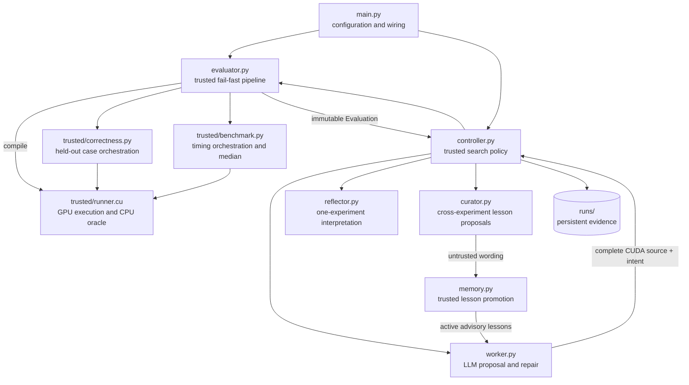
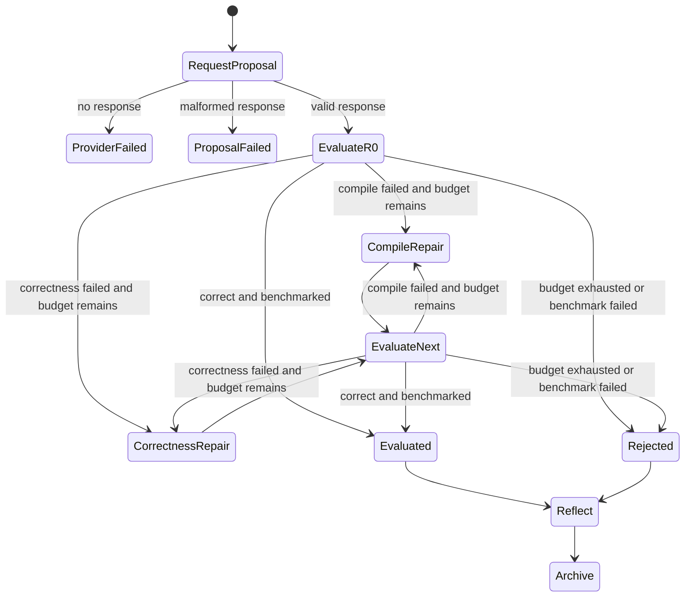

# KernelBunny Architecture Guide

This document explains KernelBunny as it exists today. It is written as an
interview study guide: first understand the central design decision, then the
data flow, then the individual components and their tradeoffs.

## 1. The system in one sentence

KernelBunny is a bounded evolutionary search harness in which an LLM proposes
CUDA SGEMM implementations, while trusted code independently decides whether
each proposal compiles, is correct, is fast enough to keep exploring, and when
the search must stop.

The most important sentence to remember is:

> The model proposes experiments; the harness defines and measures success.

This is not merely an LLM that writes CUDA. It is an experimental loop with an
explicit trust boundary, controlled state transitions, and persistent evidence.

## 2. System map



The implementation is deliberately synchronous. There are several logical LLM
roles, but no distributed workers, queues, workflow framework, or search-tree
library. Each role is just a prompt against the same provider interface.

## 3. The trust boundary

The trust boundary is the core architectural decision.

| Agent-controlled and untrusted | Harness-controlled and trusted |
|---|---|
| Candidate CUDA source | Candidate and revision IDs |
| Worker intent | Compilation result |
| Repair proposal | Correctness tests and result |
| Reflection hypothesis | Benchmark workload and runtime |
| Curator lesson wording | Candidate and repair budgets |
| | Population selection and best-ever state |
| | Stopping conditions and memory promotion |

An LLM response is always treated as input, never as proof. For example, a
worker can claim that a kernel is vectorized or 30% faster, but that claim has
no effect on selection. Only the evaluator's `Evaluation.runtime_ms` can affect
trusted search state.

### Why the controller owns policy

The controller owns IDs, retry authorization, budgets, selection, and stopping
because those decisions determine how much compute is spent and what counts as
progress. If the worker owned them, it could request unlimited retries, assign
itself a favorable score, hide failures, or decide that the experiment should
continue forever.

### Why correctness is a hard constraint

Runtime is considered only after correctness succeeds. Correctness is not one
term in a weighted score because a numerically wrong SGEMM does not become
useful by being fast. This also makes selection simple: invalid candidates never
enter the population.

### What the worker is allowed to see

The worker receives:

- The public SGEMM contract and required launcher ABI.
- Its current parent's complete source.
- Trusted parent and global-best runtimes.
- A small recent reflection history from its own ancestry.
- A small set of active global lessons, explicitly labeled as advisory.

It does not receive the exact correctness cases or benchmark dimensions. A
correctness repair receives only a generic diagnostic about likely categories
such as indexing, bounds, synchronization, initialization, and numerical
behavior. A compilation repair may receive the compiler diagnostic because
that is needed to fix syntax and toolchain errors.

## 4. Core data model

The shared records in `models.py` are frozen dataclasses. Immutability makes it
harder for one component to silently rewrite trusted observations after the
fact.

### `Candidate`

```text
Candidate
├── id             logical experiment identity, for example C0002
├── revision       source revision number, for example 0, 1, or 2
├── parent_id      exact source revision this code came from
├── source_path    location of the complete CUDA source
└── worker_intent  what the worker says it attempted
```

`Candidate.revision_id` derives the exact source identity as `C0002/r1`. The
logical ID stays constant through repairs; the revision number changes whenever
the source changes.

The baseline is represented in the same shape and is normally `baseline/r0`.

### `Evaluation`

```text
Evaluation
├── candidate_id
├── compile_success
├── compile_log
├── correctness_success     true, false, or not run
├── correctness_log
├── runtime_ms              trusted median, or absent
└── benchmark_log
```

Compilation, correctness, and runtime do not live on `Candidate`. They are
observations made by the evaluator, not properties the worker may declare.
`candidate_id` binds the observation to one exact revision.

`correctness_success` is optional because `None` means the stage was not run,
usually because compilation failed. Likewise, `runtime_ms=None` means no valid
benchmark result exists.

### Intent versus reflection

`worker_intent` records the proposed reason for the edit before measurement. A
`Reflection` is a separate post-hoc interpretation containing:

- `what_changed`: a factual source-level summary.
- `observed`: supplied trusted outcomes.
- `hypothesis`: a cautious possible explanation.
- `confidence`: low, medium, or high.

Keeping these separate prevents an intended optimization from being mistaken
for a demonstrated causal explanation.

### Memory lessons

A `MemoryLesson` has a harness-assigned ID, concise text, evidence candidate
IDs, and one of `active`, `low_priority`, or `archived`. Lesson text remains
untrusted advice. It can guide the next prompt but cannot bypass evaluation.

## 5. End-to-end execution

### Startup and baseline gate

`main.py` parses either the `baseline` or `search` command, loads `.env`, and
constructs trusted configuration objects. It then creates a baseline
`Candidate` from the selected CUDA file and sends it through the same evaluator
used for generated candidates.

The baseline must compile, pass correctness, and produce a runtime before an
LLM client or controller is allowed to start. This proves the GPU, compiler,
runner, source ABI, and test pipeline are usable without spending model budget.

### Search initialization

`Controller.run_search()` creates an independent search record, then initializes:

- Active population: the validated baseline.
- Best-ever candidate: the validated baseline.
- Candidate and generation counters: zero.
- No-improvement counter: zero.
- Branch reflection histories: initially empty.
- Active global memory: loaded from disk when configured.

It persists `state.json` immediately, before proposing a child.

### One generation

For each configured child number, the controller visits each active parent in
order. Each parent may produce a logical child through `run_candidate()` until
the candidate budget is exhausted.

```text
active parents
    -> propose and evaluate children
    -> discard invalid children from selection pool
    -> update best-ever for every faster valid child
    -> select next active population
    -> optionally curate accumulated reflections
    -> persist search state
    -> check stop conditions
```

The current implementation is sequential. This makes IDs, artifact writes,
budget accounting, and debugging deterministic enough for the MVP.

## 6. Candidate lifecycle and bounded repair

A logical candidate consumes at most one candidate-budget slot even if it has
several authorized source revisions.



Example:

```text
C0002/r0  initial proposal; fails compilation
C0002/r1  one authorized compilation repair; fails correctness
C0002/r2  one authorized correctness repair; passes and is benchmarked
```

The repair parent is the immediately failed revision, while candidate-level
metadata also retains the original validated parent. The repair prompt receives
both the original working parent and the failed source. That gives the model a
known-good fallback without erasing the attempted optimization.

The controller increments and checks repair counters. The worker cannot request
another attempt. With a repair limit of one, an initial failure may receive one
repair; if that repair fails in the same category, the lifecycle ends.

### Candidate-budget accounting

- Provider failure before any response does not consume a candidate slot.
- A malformed proposal response does consume a slot: the model invocation
  produced an attempted experiment, even though it could not be parsed.
- A materialized proposal consumes one slot regardless of its repair count.
- Repairs never consume additional candidate slots.

Terminal statuses preserve why work stopped, including `evaluated`,
`provider_failed`, `proposal_failed`, `compile_repair_exhausted`,
`correctness_repair_exhausted`, `benchmark_failed`, and repair-provider or
repair-parse failures.

## 7. Trusted evaluator pipeline

`Evaluator.evaluate()` is fail-fast:

```text
candidate.cu
    -> compile with trusted runner
    -> held-out correctness suite
    -> benchmark with independent output checks
    -> immutable Evaluation
```

If compilation fails, correctness and benchmarking do not run. If correctness
fails, benchmarking does not run. A benchmark failure yields no runtime.

### Why `runner.cu` and candidate source are compiled together

The candidate file implements exactly one exported function:

```cpp
extern "C" void launch_sgemm(
    const float* a,
    const float* b,
    float* c,
    int m,
    int n,
    int k,
    cudaStream_t stream
);
```

`runner.cu` supplies `main()`, input generation, GPU allocation, calls to that
function, validation, and timing. `nvcc` links the trusted runner and untrusted
candidate into a temporary executable. The candidate can change the kernel and
launcher implementation but not the executable's test protocol.

### Where the tests actually live

The Python and CUDA layers have different responsibilities:

| Layer | Responsibility |
|---|---|
| `correctness.py` | Defines held-out `(M, N, K, seed)` cases, invokes the runner once per case, enforces timeouts, and interprets its protocol. |
| `benchmark.py` | Defines the benchmark configuration, invokes repeated timing, validates returned samples, and calculates the median. |
| `runner.cu` | Generates concrete matrices, computes the CPU oracle, runs the candidate on the GPU, compares outputs, and measures launches. |

So `correctness.py` and `benchmark.py` are trusted test orchestrators, while
`runner.cu` contains the low-level test implementation.

### Why the reference is CPU code, not the naive CUDA baseline

The oracle should fail independently from the code under test. Comparing one
CUDA candidate with another CUDA kernel could preserve a shared indexing,
launch, or synchronization bug. The simple CPU triple loop is slow but obvious
and independent, and the correctness cases are small enough for that cost to be
reasonable.

The naive CUDA kernel is a performance starting point, not the definition of
mathematical truth.

### Correctness details

Inputs are deterministic pseudo-random FP32 matrices. The held-out suite mixes
tiny, irregular, and non-tile-aligned shapes. Output is accepted when each value
satisfies an absolute-plus-relative tolerance of `1e-3 + 1e-3 * |expected|`.
Non-finite outputs fail.

The benchmark uses a separate fixed SGEMM workload. It validates output during
every measured iteration, which is why a candidate can pass the small
correctness suite yet still be denied a runtime during benchmarking.

### Timing details

Defaults are ten warm-up launches and fifty measured launches. Each measured
sample surrounds the launch with device synchronization, and Python uses the
median rather than a single observation. The median is more resistant to
occasional system noise.

The current runner uses `std::chrono::steady_clock` around the launch plus a
post-launch `cudaDeviceSynchronize()`. This is useful for coarse end-to-end
comparisons and includes launch/synchronization overhead. It is not pure GPU
kernel time; CUDA-event timing is a sensible post-MVP improvement.

## 8. Population, best-ever state, and selection

Three state concepts must remain distinct:

| State | Meaning |
|---|---|
| Archive | Every attempted candidate and repair, including failures. |
| Active population | Valid candidates that may receive mutations next. |
| Best-ever | Fastest valid candidate observed across the entire search. |

The archive exists for observability, not search eligibility. The active
population is a temporary frontier. Best-ever is a safety record and is updated
whenever a valid child is faster, even when the gain is below the meaningful
improvement threshold.

### Current selection policy

Parents and valid offspring form the selection pool. Entries are ranked by
trusted runtime, with revision ID as a deterministic tie-breaker.

1. Keep up to the two fastest entries.
2. If there is another slot, prefer the fastest candidate from a parent family
   not represented by those entries.
3. Fill any remaining slots by runtime.

This is a small exploitation-plus-exploration policy. The fast slots exploit
known performance; the family-aware slot reduces the chance that one branch
immediately eliminates every alternative. It is intentionally much simpler
than MCTS, embeddings, or a general evolutionary framework.

### Meaningful improvement

The default threshold is 2% relative to a child's direct parent. It answers
whether a generation made enough progress to reset the stagnation counter. It
does not redefine the measured runtime and does not prevent a slightly faster
valid candidate from becoming best-ever or being selected.

This distinction avoids overstating noisy tiny gains while preserving accurate
trusted observations.

## 9. Stopping conditions

The controller checks, in this priority order:

1. Maximum logical candidates consumed.
2. Maximum consecutive generations without meaningful improvement.
3. Maximum generations attempted.

Only a generation that consumes at least one candidate affects the stagnation
counter. Provider failures therefore do not falsely count as performance
stagnation, while the generation limit still guarantees eventual termination.

Workers never decide when to stop. Wall-clock limits, target-speedup stopping,
and resumable searches are not implemented in the MVP.

## 10. Reflection and global memory

### Reflector: one experiment

After a materialized candidate reaches a terminal state, the reflector receives
the original parent, final candidate, unified source diff, worker intent,
sanitized revision outcomes, and available trusted runtimes. It does not receive
hidden correctness inputs or invented profiler metrics.

Reflection failure never changes the candidate's evaluation. Raw output, parse
errors, and successful structured reflections are archived separately.

### Curator: evidence across experiments

Every configured number of generations, the curator sees accumulated
reflections and existing non-archived lessons. It proposes concise lessons and
must cite only evidence IDs that were supplied in that curation window.

The model proposes the wording; `MemoryBank` controls identity and promotion:

- A lesson becomes active after evidence from at least two candidates.
- A single candidate can activate a lesson if its validated improvement is at
  least the configured large-improvement threshold, currently 10%.
- Otherwise a new lesson starts as low priority.
- Previously active lessons remain active when updated.
- Stale low-priority lessons move to archived on a later memory update.
- An active-lesson cap keeps worker context bounded.

If curation fails, pending evidence is retained for a future scheduled attempt.
Global memory is a soft prompt influence, never a correctness rule or scoring
input.

## 11. Persistent evidence and recoverability

The filesystem is the long-term experiment memory. The LLM context only carries
a small relevant subset.

```text
runs/
├── C0001/
│   ├── metadata.json
│   ├── r0/
│   │   ├── candidate.cu
│   │   ├── raw_response.txt
│   │   ├── compile.log
│   │   ├── correctness.log
│   │   ├── benchmark.log
│   │   ├── evaluation.json
│   │   └── metadata.json
│   └── r1/ ...
└── searches/
    └── S0001/
        ├── state.json
        └── curations/K0001/ ...
```

Candidate metadata tracks the original parent, terminal status, final revision,
budget consumption, repair counts, and reflection status. Revision metadata
tracks the immediate parent and whether it was an initial proposal or repair.

Search state records configuration, counters, active population, best-ever,
generation attempts, selection decisions, curation results, and active memory.
JSON state files use temporary-file replacement so readers do not observe a
partially written document. Large immutable artifacts use exclusive creation so
an existing experiment is not silently overwritten.

Global memory has three representations:

- `global_memory.json`: machine-readable current state.
- `global_memory.md`: compact active lessons for people.
- `curation_archive.jsonl`: append-only history of curation updates.

## 12. Failure scenarios to explain

### All children fail compilation

Each failure is archived and may receive only its configured repair. Invalid
children never enter selection. The previous valid parents remain in the
selection pool, so the active population stays viable. The candidate budget and
generation limit still advance as applicable.

### A child is faster by less than 2%

The trusted runtime is kept. The child may be selected and may become best-ever,
but the generation does not reset the no-meaningful-improvement counter. The
system distinguishes a measured difference from a confidently meaningful gain.

### The exploration candidate is slower

That is allowed. Its role is to preserve another search direction, while the
two exploitation slots retain fast candidates. Best-ever remains separate and
cannot be erased by the slower branch.

### A worker returns invalid JSON

Parsing fails closed. No source is guessed from prose or Markdown. The raw
response and error are archived, the attempt consumes a candidate slot, and the
controller moves on.

### The LLM provider fails

No candidate source exists, so no candidate slot is consumed. The failure is
archived. Maximum generations still bounds repeated provider failures.

### Correctness passes but benchmarking rejects output

No runtime is assigned and the candidate is excluded. This is expected defense
in depth: the benchmark workload performs its own output validation instead of
assuming the smaller held-out suite proved all shapes correct.

### Reflection or curation fails

Evaluation and selection remain valid because explanatory LLM roles are not in
the trusted scoring path. Their failures are observable but cannot invalidate a
measured candidate or manufacture a performance result.

## 13. Why this architecture is intentionally simple

The project has one synchronous controller, immutable records, explicit prompt
roles, filesystem persistence, and a standard-library HTTP client. This makes
the state transitions inspectable and allows every trusted decision to be found
in ordinary Python.

The design avoids LangGraph, queues, distributed workers, databases, MCTS,
embedding-based novelty, and profiler-driven optimization because none is
required to demonstrate the central idea. Those tools would increase the
failure surface and make a one-day interview project harder to explain before
the basic closed loop was proven.

## 14. Known limitations and honest technical debt

- Candidate code executes on the host-visible GPU without a dedicated security
  sandbox. A Docker Sandbox or similarly restricted execution boundary is the
  most important safety improvement before accepting adversarial code.
- Timing uses a synchronized host clock rather than CUDA events and tests only
  one benchmark shape. Results are useful experiments, not broad performance
  claims.
- There is no cuBLAS comparison. The baseline is the naive project kernel, not
  a vendor-library gold standard.
- Search is sequential, so GPU and provider latency are not overlapped.
- Search state can be inspected but not resumed after interruption.
- Directory-based numeric ID allocation is designed for one controller process;
  concurrent searches would need locking or UUID-backed reservation.
- The CPU reference is intentionally simple and independent, but it is not
  practical for very large correctness matrices.
- The provider client is structurally provider-neutral through the `LLM`
  protocol, but only DeepSeek is implemented.
- Hidden inputs reduce direct overfitting; they are not a cryptographic security
  boundary against code intentionally attempting to inspect its environment.

## 15. A concise interview explanation

If asked to explain KernelBunny in two minutes, use this sequence:

1. **Problem:** LLM-generated kernels cannot be trusted to report their own
   correctness or speed.
2. **Boundary:** The LLM owns source proposals and hypotheses; the harness owns
   tests, scores, budgets, selection, and stopping.
3. **Lifecycle:** Every proposal gets a controller-assigned identity, then goes
   through compile, held-out correctness, and robust benchmarking, with bounded
   controller-authorized repair.
4. **Search:** A tiny population keeps fast candidates plus one alternative
   family, while best-ever is tracked independently.
5. **Learning:** A reflector explains one experiment; a curator proposes only
   compact cross-experiment advice; neither can alter trusted outcomes.
6. **Observability:** Every source revision, model response, test log, runtime,
   reflection, selection decision, and memory update remains on disk.
7. **Tradeoff:** The architecture is sequential and simple on purpose, proving
   the trustworthy end-to-end loop before adding concurrency or sophisticated
   search.

## 16. Questions you should be ready to answer

- Why are `Candidate` and `Evaluation` separate records?
- Why does the controller, rather than the worker or evaluator, own retries?
- Why is the CPU implementation the oracle instead of the naive CUDA kernel?
- Why does a benchmark still validate output after correctness passed?
- What is the difference between archive, active population, and best-ever?
- Why can a sub-2% improvement become best-ever without resetting stagnation?
- What failure would occur if every branch received every other branch's full
  source history?
- Why are reflections hypotheses rather than trusted causal explanations?
- Why can global memory influence prompts but never acceptance criteria?
- Which production improvement comes first: sandboxing, CUDA-event timing,
  broader workloads, concurrency, or resumability, and why?

The strongest answers always return to ownership, independent evidence,
bounded resource use, and keeping the smallest system that proves the idea.
